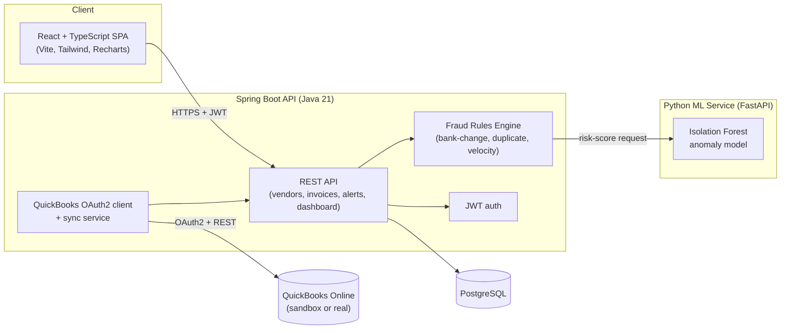

# SentinelAP — AP Invoice & Vendor Fraud Detection

SentinelAP flags fraudulent and anomalous accounts-payable invoices *before* they get paid — vendor bank-account-change fraud (business email compromise), duplicate invoices, invoice-volume velocity spikes, and statistical outliers caught by a machine-learning anomaly model — without requiring a company to rip out its existing accounting software. It reads from QuickBooks Online (or a built-in synthetic dataset) and layers a fraud-detection and case-management workflow on top.

This exists to demonstrate a full-stack, AI-assisted fraud-detection product end to end: a Java/Spring Boot API, a Python ML microservice doing real anomaly detection (not just if/else rules), a React/TypeScript dashboard, a real OAuth2 integration with a third-party accounting API, and a containerized, cloud-deployable architecture.

## Table of contents

- [Architecture](#architecture)
- [Tech stack](#tech-stack)
- [Quick start (Docker Compose)](#quick-start-docker-compose)
- [Running services individually (local dev)](#running-services-individually-local-dev)
- [The fraud-detection logic](#the-fraud-detection-logic)
- [QuickBooks Online integration](#quickbooks-online-integration)
- [Deploying to Render](#deploying-to-render)
- [API reference](#api-reference)
- [Project structure](#project-structure)
- [Known limitations & honest caveats](#known-limitations--honest-caveats)
- [Resume bullet points](#resume-bullet-points)
- [Roadmap / what a real v2 would need](#roadmap--what-a-real-v2-would-need)

## Architecture



Every invoice — whether synthetically seeded or pulled from QuickBooks — passes through the same pipeline: the rules engine checks it for the three deterministic fraud patterns, then hands it to the ML service for an isolation-forest anomaly score, and any hit becomes a `FraudAlert` the frontend surfaces immediately.

## Tech stack

| Layer | Choice | Why |
|---|---|---|
| Backend API | Java 21, Spring Boot 3.3, Spring Security (JWT), Spring Data JPA | Matches the target stack; modern Spring (records, virtual-thread-ready runtime) |
| Database | PostgreSQL 16, Flyway migrations | Versioned schema, production-realistic |
| ML service | Python 3.11, FastAPI, scikit-learn (IsolationForest) | Real anomaly detection, not hand-rolled rules |
| Frontend | React 19, TypeScript, Vite, Tailwind CSS v4, Recharts, React Router | Current, fast-building, resume-relevant stack |
| Auth | JWT (jjwt), BCrypt password hashing | Stateless API auth |
| API docs | springdoc-openapi (Swagger UI at `/swagger-ui.html`) | Self-documenting API |
| Integration | QuickBooks Online OAuth2 + REST (sandbox or production) | Real third-party accounting API, not just mock data |
| Containerization | Docker, Docker Compose | One-command local environment |
| CI | GitHub Actions (backend test+build, ML test, frontend build, Docker image builds) | Catches regressions on every push |
| Deployment | Render (`render.yaml` blueprint) | Free-tier-friendly, one-click-ish deploy |

## Quick start (Docker Compose)

Requires Docker and Docker Compose.

```bash
git clone <your-fork-url> sentinelap
cd sentinelap/infra
docker compose up --build
```

This starts four containers: Postgres, the ML service, the backend (which seeds a synthetic demo dataset on first boot — vendors, invoices, and three deliberately-injected fraud patterns so the dashboard isn't empty), and the frontend.

- Frontend: http://localhost:5173
- Backend API + Swagger UI: http://localhost:8080/swagger-ui.html
- ML service: http://localhost:8000/health

**Demo login:** `demo@sentinelap.com` / `Demo1234!` (created by the seeder; printed to the backend logs on first boot too).

## Running services individually (local dev)

**Backend** (needs Postgres running — the `docker compose up postgres` from the compose file above, or your own local instance on port 5432 with a `sentinelap`/`sentinelap`/`sentinelap` db/user/password):

```bash
cd backend
mvn spring-boot:run
```

**ML service:**

```bash
cd ml-service
python3 -m venv .venv && source .venv/bin/activate
pip install -r requirements.txt
uvicorn app.main:app --reload --port 8000
```

**Frontend:**

```bash
cd frontend
cp .env.example .env   # points VITE_API_BASE_URL at localhost:8080
npm install
npm run dev
```

## The fraud-detection logic

Every invoice runs through `FraudRulesEngine` (`backend/src/main/java/com/sentinelap/service/FraudRulesEngine.java`):

1. **Bank-account-change fraud** — CRITICAL severity. If the vendor's payout bank account changed within the last 30 days, any invoice submitted after that is flagged. This is the single highest-signal indicator of vendor-impersonation / business-email-compromise fraud in real AP fraud data.
2. **Duplicate invoice** — HIGH severity. Same vendor, amount, and invoice number as an existing invoice (via a SHA-256 fingerprint).
3. **Velocity anomaly** — MEDIUM severity. A vendor submitting an abnormal number of invoices in a 30-day window relative to typical cadence.
4. **ML anomaly** — HIGH/CRITICAL depending on score. Every invoice's features (amount, vendor age, recent invoice count, whether a bank change happened recently, whether it resembles a duplicate, an amount z-score) are sent to the Python ML service, which runs them through an isolation forest trained on a synthetic distribution of normal vs. fraudulent invoicing patterns and returns a 0–100 risk score plus the top contributing factors (see `ml-service/app/model.py` for the scoring/explainability approach).

The ML service fails **soft**: if it's unreachable, the backend falls back to rules-only scoring rather than blocking invoice processing — a deliberate reliability choice for a payments-adjacent system.

## QuickBooks Online integration

Disabled by default (`sentinelap.quickbooks.enabled=false` / `QBO_ENABLED=false`) so the app runs entirely on synthetic data with zero setup. To connect a real (free, sandbox) QuickBooks company:

1. Create a free account at [developer.intuit.com](https://developer.intuit.com) and create an app.
2. Under your app's **Keys & OAuth** tab, grab the sandbox **Client ID** and **Client Secret**, and add `http://localhost:8080/api/integrations/quickbooks/callback` as an allowed redirect URI.
3. Under the **Sandbox** tab, note your test company; QuickBooks pre-populates it with sample vendors and bills, which is convenient for a first sync.
4. Set these environment variables for the backend (see `docker-compose.yml` or your local `.env`):
   ```
   QBO_ENABLED=true
   QBO_CLIENT_ID=<your sandbox client id>
   QBO_CLIENT_SECRET=<your sandbox client secret>
   QBO_REDIRECT_URI=http://localhost:8080/api/integrations/quickbooks/callback
   QBO_ENVIRONMENT=sandbox
   ```
5. Restart the backend, then visit `http://localhost:8080/api/integrations/quickbooks/connect` in a browser — it redirects to Intuit's real OAuth consent screen. Approve it against your sandbox company.
6. Trigger a sync: `curl -X POST http://localhost:8080/api/integrations/quickbooks/sync` (with an `Authorization: Bearer <jwt>` header from `/api/auth/login`). This pulls real `Vendor` and `Bill` records from the sandbox company, maps them into SentinelAP's own model, and runs every imported bill through the same fraud pipeline as synthetic data.

This is real OAuth2 + REST code against Intuit's actual sandbox endpoints (`backend/src/main/java/com/sentinelap/integration/quickbooks/`) — nothing about it is mocked, it just needs your own free developer credentials to exercise.

## Deploying to Render

1. Push this repo to your own GitHub account.
2. In the [Render dashboard](https://dashboard.render.com), choose **New > Blueprint** and point it at the repo — Render reads `render.yaml` at the root and creates a free Postgres database plus the three services (ml-service, backend, frontend) in one go.
3. The database URL and the backend↔ml-service link wire up automatically. Two values can't be, because the frontend and backend each need the other's *public* URL before either has been deployed:
   - Once the backend service is live, copy its `https://sentinelap-backend-xxxx.onrender.com` URL and set it as the frontend service's `VITE_API_BASE_URL` env var, then trigger a redeploy of the frontend (static sites bake env vars in at build time).
   - Once the frontend service is live, copy its URL and set it as the backend's `ALLOWED_ORIGINS` env var, then redeploy the backend.
4. Demo login is the same seeded account: `demo@sentinelap.com` / `Demo1234!`.

**Free-tier caveats worth knowing** (so a resume reviewer clicking the link isn't confused): Render's free Postgres databases expire 30 days after creation, and free web services spin down after 15 minutes of inactivity, so the first request after a while will have a ~30-60 second cold-start delay. Fine for a portfolio demo; upgrade to a paid instance (from ~$7/mo) if you want it always warm.

## API reference

Full interactive docs at `/swagger-ui.html` once the backend is running. Highlights:

| Endpoint | Method | Auth | Description |
|---|---|---|---|
| `/api/auth/login` | POST | none | Returns a JWT |
| `/api/dashboard/summary` | GET | JWT | KPIs, alert-type breakdown, recent alerts |
| `/api/vendors` | GET | JWT | All tracked vendors with risk scores |
| `/api/invoices` | GET | JWT | All invoices, flagged status included |
| `/api/alerts` | GET | JWT | All fraud alerts, optional `?status=` filter |
| `/api/alerts/{id}/status` | PATCH | JWT | Update an alert's review status |
| `/api/integrations/quickbooks/status` | GET | JWT | Whether QuickBooks is enabled/connected |
| `/api/integrations/quickbooks/connect` | GET | JWT | Starts the OAuth2 flow (redirects to Intuit) |
| `/api/integrations/quickbooks/sync` | POST | JWT | Pulls vendors + bills from the connected QuickBooks company |

## Project structure

```
sentinelap/
├── backend/          Spring Boot API (Java 21)
│   ├── src/main/java/com/sentinelap/
│   │   ├── domain/          JPA entities
│   │   ├── repo/            Spring Data repositories
│   │   ├── service/         Fraud rules engine, dashboard/vendor/invoice services
│   │   ├── integration/quickbooks/   OAuth2 client + sync service
│   │   ├── security/        JWT filter + service
│   │   ├── config/          Security, OpenAPI, DB-URL parsing, QuickBooks config
│   │   └── web/             REST controllers
│   └── src/main/resources/db/migration/   Flyway SQL migrations
├── ml-service/       FastAPI + scikit-learn anomaly scoring
│   └── app/          features.py, synthetic_training_data.py, model.py, main.py
├── frontend/         React + TypeScript SPA
│   └── src/          pages/, components/, api/, context/
├── infra/
│   └── docker-compose.yml
├── render.yaml       Render deploy blueprint
└── .github/workflows/ci.yml
```

## Known limitations & honest caveats

Being upfront about these matters more than pretending they don't exist:

- **This backend was built in a sandboxed environment where Maven Central was blocked by network policy**, so `mvn compile`/`mvn test` could not be run there. The code was hand-verified carefully (entity/column name mappings, JWT and Spring Security 6 API usage, Jackson record serialization for the ML request/response contract), and the ML service and frontend *were* fully built and tested in that same environment (4/4 Python tests passing, clean TypeScript build) — but treat the backend's first `mvn clean verify` (either locally or via the included GitHub Actions workflow) as the real first compile check, and fix forward from whatever it finds.
- The ML model is trained on **synthetic** data at startup, not real historical fraud outcomes — it demonstrates a real anomaly-detection architecture, but its actual precision/recall on real invoices is unknown until it's retrained on real data.
- Auth is single-tenant (one shared demo login for the whole seeded dataset) — there's no multi-organization data isolation. Real production use would need that before onboarding more than one company's data.
- The QuickBooks sync is intentionally simple (initial import, not incremental/webhook-based) — a real integration would use QuickBooks' webhook/CDC APIs to stay in sync continuously rather than re-querying on demand.

## Resume bullet points

Feel free to adapt directly:

- Built SentinelAP, a full-stack AP fraud-detection platform (Java/Spring Boot, Python/FastAPI, React/TypeScript) that combines a deterministic rules engine with a scikit-learn isolation-forest anomaly model to flag vendor bank-account-change fraud, duplicate invoices, and invoicing-velocity anomalies in real time.
- Implemented a real OAuth2 integration with the QuickBooks Online API to ingest live vendor and bill data, mapping third-party accounting records into an internal fraud-detection pipeline.
- Designed a microservice architecture where the Spring Boot API calls a Python ML service for anomaly scoring, with graceful degradation (rules-only fallback) when the ML service is unavailable.
- Containerized all services with Docker and shipped a one-command local dev environment (Docker Compose) plus a CI/CD pipeline (GitHub Actions) and a cloud deployment blueprint (Render).

## Roadmap / what a real v2 would need

- Multi-tenant data isolation (organization-scoped rows + row-level security)
- Retraining the ML model on real labeled fraud outcomes instead of synthetic data, with a proper train/validation split and precision/recall tracking over time
- Incremental QuickBooks sync via webhooks instead of full re-query
- Role-based access control (analyst vs. admin vs. read-only)
- An audit log of every status change on an alert, for compliance/legal defensibility
